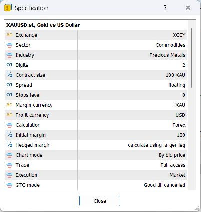
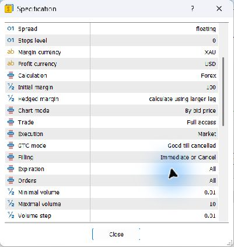
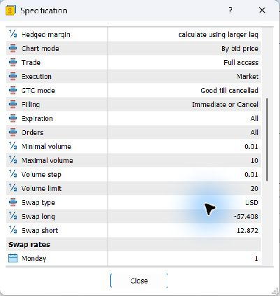
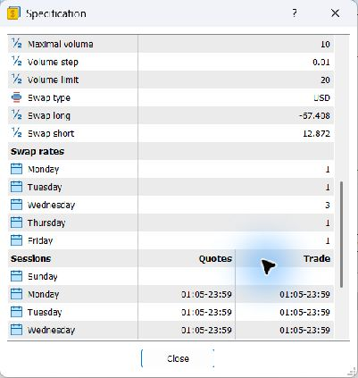
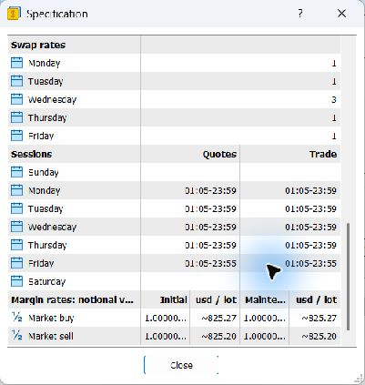

# مشاهده فقط‌خواندنی XAUUSD.st در MT5 ویندوز
تاریخ: ۲۰۲۶-۱۱-۰۵؛ مجوز Issue9/6652009173.

ترمینال از قبل باز بود؛ بدون launch، ورود، انتخاب حساب، API یا تغییر AutoTrading/EA از همان پنجره استفاده شد. مسیر مشاهده: Market Watch → نماد دقیق XAUUSD.st → Specification؛ اسکرول تا انتهای فهرست. تنها نمایش/عرض پنل برای خواندن تغییر کرد؛ هیچ تنظیم معاملاتی، حساب یا حفاظتی و هیچ order/stop تغییر نکرد. پنجره Specification پس از ثبت بسته شد. هنگام تلاش برای بازگرداندن عرض پنل، ابزار ورود کاربر را تشخیص داد؛ اقدام بیشتری روی پنجره انجام نشد.

## زمینه مشاهده و حدود اعتبار
عنوان ترمینال: server **ePlanet-MT5**؛ **Demo Account – Hedge**؛ **ePlanet Brokers Ltd**؛ نمودار XAUUSD.st,M15. شماره حساب عمداً در گزارش و تصاویر حذف شده است. نوع تجاری حساب مانند ECN/Zero/Gold از عنوان معلوم نیست؛ suffix .st را به Standard تعبیر نمی‌کنیم.
Market Watch در بازه مشاهده حدود 09:10 تا09:15 نمایش می‌داد؛ زمان UTC ثبت شواهد حدود07:11 تا07:14 است. این هم‌زمانی تقریبی، مدرک timezone/DST تاریخی سرور نیست؛ ساعات session را به UTC تبدیل نکردیم.
این یک snapshot **دمو** است؛ تطبیق شرایط با حساب واقعی، قرارداد حقوقی، وضعیت گذشته و آینده یا تضمین fill از آن نتیجه نمی‌شود.

## جدول مقادیر
| پارامتر | مقدار مشاهده‌شده / وضعیت | شاهد |
|---|---|---|
| Symbol / description | XAUUSD.st / Gold vs US Dollar | 01 |
| Exchange / sector / industry | XCCY / Commodities / Precious Metals | 01 |
| Digits | 2 | 01 |
| Contract size | 100 XAU | 01 |
| Spread | floating؛ مقدار معمول یا تاریخی معلوم نیست | 01/02 |
| Stops level | 0 | 01/02 |
| Margin currency / profit currency | XAU / USD | 01/02 |
| Calculation | Forex | 01/02 |
| Initial margin (فیلد بالایی) | 100؛ واحد/معنای عملی را با leverage یا USD یکی نمی‌گیریم | 01/02 |
| Hedged margin | calculate using larger leg | 01/02/03 |
| Chart mode | By bid price | 01/02/03 |
| Trade | Full access؛ فقط مقدار نمایش‌داده‌شده، نه مجوز معامله | 01/02/03 |
| Execution | Market | 01/02/03 |
| GTC mode | Good till cancelled | 01/02/03 |
| Filling | Immediate or Cancel | 02/03 |
| Expiration / Orders | All / All | 02/03 |
| Minimal / Maximal volume | 0.01 / 10 | 02/03 |
| Volume step / Volume limit | 0.01 / 20 | 03/04 |
| Swap type | USD | 03/04 |
| Swap short | 12.872 | 03/04 |
| Swap long | **اختلاف خوانش:** تصویر 03/04 ظاهراً -57.408، متن دسترس‌پذیری ابزار -67.408؛ عدد قطعی تأیید نشده | 03/04 |
| Swap rates | Mon1 / Tue1 / Wed3 / Thu1 / Fri1 | 04/05 |
| Margin rates heading | notional value | 05 + متن رابط |
| Market buy: Initial / Maintenance multiplier | متن رابط: 1.0000000 / 1.0000000؛ تصویر به‌علت عرض ستون کوتاه‌شده | 05 |
| Market buy: Initial / Maintenance USD per lot | تقریباً825.27 / تقریباً825.27 | 05 |
| Market sell: Initial / Maintenance multiplier | متن رابط: 1.0000000 / 1.0000000؛ ستون تصویر کوتاه‌شده | 05 |
| Market sell: Initial / Maintenance USD per lot | تقریباً825.20 / تقریباً825.20 | 05 |
| Point | فیلد مستقلی دیده نشد؛ از Digits عدد مستقلی به‌عنوان مشاهده جعل نشده | نامعلوم |
| Tick size / tick value | فیلد دیده نشد؛ از contract/digits استنتاج عملیاتی نشده | نیازمند سند بروکر |
| Freeze level | دیده نشد؛ صفر فرض نشده | نیازمند سند بروکر |
| Leverage واقعی حساب/نماد | نمایش داده نشد؛ از margin تقریبی استخراج نشده | نیازمند سند بروکر |
| Commission، minimum، per-side/roundtrip | در فهرست تا انتها دیده نشد | نامعلوم، نه صفر |
| Rollover clock / تاریخچه swap و تعطیلات | نمایش داده نشد | نیازمند سند بروکر |
| Spread تاریخی / slippage / latency اجرای واقعی | snapshot Specification این‌ها را اثبات نمی‌کند | نامعلوم |

اختلاف swap long عمداً حل‌نشده باقی مانده؛ هیچ عددی برای شبیه‌سازی جدید انتخاب نشد. مقادیر margin با علامت تقریب ثبت شده‌اند و به قیمت/حساب و زمان snapshot وابسته‌اند؛ ثابت قراردادی یا هزینه معامله محسوب نمی‌شوند.

## Sessions، عین ساعت نمایش، بدون تبدیل timezone
| روز | Quotes | Trade |
|---|---|---|
| Sunday | خالی | خالی |
| Monday | 01:05–23:59 | 01:05–23:59 |
| Tuesday | 01:05–23:59 | 01:05–23:59 |
| Wednesday | 01:05–23:59 | 01:05–23:59 |
| Thursday | 01:05–23:59 | 01:05–23:59 |
| Friday | 01:05–23:55 | 01:05–23:55 |
| Saturday | خالی | خالی |

خالی‌بودن جدول هفتگی شنبه/یکشنبه ثبت شد؛ تقویم استثناهای تعطیلات یا نگاشت تاریخی DST از آن استخراج نشده است.

## تصاویر واقعی و حفاظت
پنج تصویر زیر **خروجی مستقل همان dialog Specification** هستند؛ تصویر parent شامل شماره حساب، موجودی و زمینه خصوصی در بسته نیست. خود پنجره مستقل هیچ اطلاعات شناسایی نشان نمی‌داد، بنابراین نیاز به پوشاندن عددی داخل آن نبود؛ پیکسل‌های فنی تغییر، بازنویسی یا تولید مصنوعی نشده‌اند. همه تصاویر پیش از upload دیده و بررسی شدند. manifest شامل هش SHA256، Git blob و زمان ثبت مدرک است؛ زمان ثبت ممکن است چند ثانیه پس از capture باشد. پیوست‌ها بخش‌های متوالی یک dialog هستند، نه نمادهای متفاوت.

1. [قرارداد و قیمت](images/01-contract.png)
2. [اجرا و حجم](images/02-execution-volume.png)
3. [حجم و swap](images/03-volume-swap.png)
4. [ضرایب swap و شروع جلسات](images/04-swap-rates.png)
5. [جلسات کامل و margin](images/05-sessions-margin.png)

## نتیجه و مدرک باقی‌مانده
ابهام contract size، digits، حجم، execution، chart side و جلسات نمایشی برای **همین نماد دمو** با شاهد واقعی کاهش یافت. اعداد فرضی PR11/12 بازنویسی نشدند؛ snapshot هیچ آزمایش قبلی را با هزینه واقعی بازاعتبارسنجی نمی‌کند.
برای هزینه قابل استفاده پژوهشی، بروکر باید specification تاریخ‌دار مخصوص همین server/account group و suffix، commission شامل minimum و جهت محاسبه، tick size/value و freeze، واحد و مقدار swap long صحیح، ساعت rollover/DST/تعطیلات و تفاوت demo/live را تأیید کند. spread/slippage تاریخی علاوه بر قرارداد به داده و شواهد اجرای مجاز جداگانه نیاز دارد. هیچ پیام پشتیبانی ارسال نشد.
هیچ سفارش DEMO/REAL، اسکریپت/Expert، اتصال جدید، Vault، تغییر حفاظت، دانلود تاریخچه، آموزش/بک‌تست یا تغییر main/PR11/12/13/ربات انجام نشد. مرحله بعد تا هماهنگی آغاز نمی‌شود.

